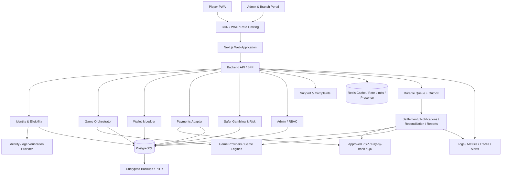

# 05 — System Architecture

## 1. Logical view

## 2. Recommended deployment topology

- **Public edge:** CDN, WAF, DDoS controls and rate limits.
- **Web:** deploy static and server-rendered UI on a frontend platform appropriate to the selected Next.js features.
- **API:** private network/container service with autoscaling, explicit request limits, health checks and controlled egress.
- **Workers:** independent worker deployment for payment webhooks, settlement, provider polling, notifications, reports and reconciliation.
- **Realtime:** separate websocket gateway or provider integration; don't couple long-lived sockets to a stateless short request runtime without verifying its limits.
- **Database:** managed PostgreSQL, private endpoint, least-privilege service accounts, point-in-time recovery and tested restore.
- **Cache/queue:** managed Redis or durable cloud messaging. Queue configuration must preserve retries, deduplication and dead-letter inspection.
- **Storage:** private object storage for approved evidence, exports and reports; no public bucket for KYC/complaint evidence.
- **Secrets:** managed vault and separate credentials per environment.

## 3. Module boundaries

### Accounts & eligibility
Owns player profile, verification references/status, restrictions, jurisdiction flags and account lifecycle. Other modules call a common eligibility policy rather than reimplementing checks.

### Game catalogue & orchestrator
Owns available game metadata, approved configurations, session lifecycle, version evidence and provider adapter. A `GameAdapter` contract isolates provider-specific mechanics from wallet/ledger code.

### Wallet & ledger
Owns accounts, journal entries, holds/reservations, available balance projection and posting rules. This is the only module allowed to post player-money ledger entries. It does not own payment network state or game rules; it receives validated internal events from those domains.

### Payments
Owns payment intents, provider identifiers, webhook inbox/dedupe, payout requests, provider reconciliation and chargeback/dispute references. It requests ledger actions through the wallet domain.

### Settlement
Owns the transition from accepted game participation to final financial settlement, with idempotency keys, result validation and compensation workflows. It coordinates game and wallet modules but does not directly edit wallet tables.

### Safer gambling & compliance
Owns configurable risk signals, case queue, account restrictions, intervention records, self-exclusion/time-out state and exportable evidence. Enforcement is queried by the common eligibility service and applied in game, payment and marketing paths.

### Admin & RBAC
Owns staff identities/role grants, organisation/branch scope, approvals, feature flag permissions and audit policy. It does not expose raw database updates.

### Reporting
Consumes committed business events and reconciled facts. Financial reports show freshness and reconciliation state; they must not be the source of authoritative player balances.

## 4. Critical transaction patterns

### Deposit
1. API validates request and creates `payment_intent` with idempotency key.
2. PSP creates checkout/QR session.
3. PSP webhook arrives at `/webhooks/{provider}`.
4. Webhook handler verifies signature/replay/time, persists a unique `provider_event`, validates amount/currency/merchant/reference.
5. In one DB transaction, update payment state and ask wallet ledger to post the deposit exactly once; record audit/outbox event.
6. A reconciler compares platform state with PSP settlement data and routes mismatches to finance.

### Stake reservation and settlement
1. Eligibility and limits checked.
2. Wallet atomically reserves funds and writes journal/hold.
3. Game session records participation and accepted rules/config version.
4. On validated result, settlement commits a unique `settlement_id` and posts payout/hold release using a single DB transaction where possible.
5. Retry of the same settlement returns the existing result; conflicting result reference triggers incident handling and no second posting.

### Withdrawal
1. Create request and reserve funds or mark amount unavailable according to approved accounting design.
2. Risk/compliance checks and maker-checker approval run.
3. Send payout via PSP; persist provider reference and outbox.
4. On final provider confirmation post the appropriate settlement entry; on failure perform an audited compensating/release entry.
5. Reconciler verifies payout against PSP settlement statement.

## 5. Domain events

Use versioned events such as:

- `account.eligibility_changed.v1`
- `game.session_created.v1`
- `game.participation_accepted.v1`
- `game.result_validated.v1`
- `wallet.journal_posted.v1`
- `payment.intent_created.v1`
- `payment.deposit_confirmed.v1`
- `payment.withdrawal_status_changed.v1`
- `safer_gambling.alert_created.v1`
- `safer_gambling.restriction_changed.v1`
- `admin.approval_completed.v1`

Events must include schema version, event ID, occurred time, aggregate ID, correlation ID and minimal necessary payload. Consumers maintain processed-event IDs to prevent duplicate effects.

## 6. Failure handling

- PSP unavailable: no optimistic credit; preserve payment intent and show pending/retry status.
- Duplicate webhook: acknowledge safely after idempotent confirmation.
- Conflicting webhook: store evidence, don't guess; open exception case.
- Provider/game disconnected mid-session: enforce documented per-game disconnect/void/finish policy; do not invent a client-side win.
- Settlement queue backlog: pause affected game if settlement integrity or player communication is at risk.
- Ledger invariant violation: alert immediately, halt affected money-moving path and require incident review.
- Database degraded: fail closed for new stakes and payouts; allow only safe read paths if data freshness is known.

## 7. High availability and recovery

Use managed multi-zone database deployment where justified, tested point-in-time restore, encrypted backups in a separate account/project, and recovery runbooks. Define recovery point/time objectives with the client. Exercise full restore in a pre-production environment and verify ledger totals plus game/payment consistency after restoration.
