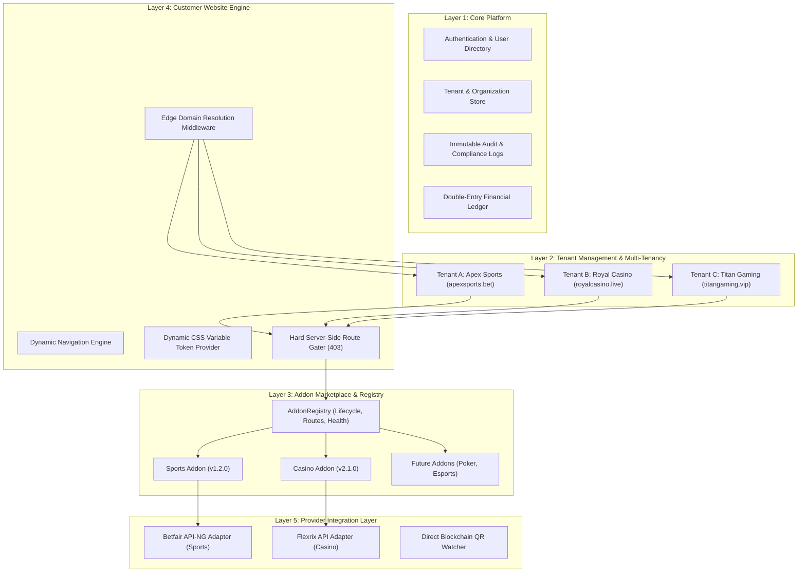

# Project Atlas — White-Label B2B Platform Architecture

## 1. Architectural Vision

Project Atlas is engineered as a scalable, modular, multi-tenant B2B gaming SaaS platform. It enables the platform operator to launch and centrally govern multiple customer websites under independent client brands, distinct color palettes, and custom domain names.

**Core Axiom: One Central Platform → Multiple Clients → Independent Brands → Plug-and-Play Addons.**

---

## 2. The Five Major Architectural Layers

### Layer 1 — Core Platform
- **Identity & RBAC**: Centralized user accounts partitioned strictly by `tenant_id`.
- **Double-Entry Ledger**: Independent chart of accounts per tenant. Real-money capabilities remain disabled during dev/test.
- **Audit & Compliance**: Centralized logging of all administrative actions with maker-checker dual controls.

### Layer 2 — Tenant Management
Every tenant profile contains:
- `tenantId` (e.g. `ten_sports_only`, `ten_casino_only`, `ten_hybrid_001`).
- `slug` (URL-friendly alias).
- `branding` (brand name, logos, favicon, primary/secondary colors, hero headings, footer text).
- `domains` (array of primary and secondary custom hostnames with SSL status).
- `gameConfigs` (granular enablement, display order, custom badges).
- `packageCode` (B2B commercial tier).

### Layer 3 — Plug-and-Play Addon Marketplace / Registry
- Central `AddonRegistry` implementing the `AddonDefinition` plugin interface.
- Addons register their route prefixes, API endpoints, configuration schemas, dependencies, and health checks.
- Zero codebase modifications required to add or configure addons.

### Layer 4 — Customer Website Experience
- Incoming HTTP requests are matched at the Next.js middleware level via `request.headers.get('host')`.
- The matching tenant configuration is resolved.
- Theme tokens are injected via CSS variables (`--tenant-primary`, `--tenant-secondary`, `--tenant-glow`).
- The navigation bar renders **strictly** the enabled addons for that tenant.
- Direct navigation to disabled addon routes triggers a **server-side HTTP 403 Forbidden** (for APIs) or redirects to `/access-denied` (for web pages).

### Layer 5 — Provider Integration Layer
- Isolated backend adapters (`BetfairAdapter`, `FlexrixAdapter`).
- Providers communicate through standard contracts.
- Credentials and environment toggles (Sandbox / Live) are maintained per tenant in encrypted storage.

---

## 3. Mandatory Tenant Configurations

| Tenant | Slug | Custom Domain | Enabled Addons | Primary Brand Color |
| :--- | :--- | :--- | :--- | :--- |
| **Tenant A** | `apex-sports` | `apexsports.bet` | `['sports']` ONLY | `#2563eb` (Blue) |
| **Tenant B** | `royal-casino` | `royalcasino.live` | `['casino']` ONLY | `#dc2626` (Crimson) |
| **Tenant C** | `titan-gaming` | `titangaming.vip` | `['sports', 'casino']` BOTH | `#7c3aed` (Purple) |

---

## 4. Security & Data Isolation Guarantees

1. **Host-Based Tenant Resolution**: Hostname is matched against `tenant_domains_v2`. If not matched, it falls back to the default platform tenant.
2. **Server-Side Route Gating**: Both `/casino/*` and `/sports/*` (as well as their underlying API endpoints `/api/v1/games/casino/*` and `/api/v1/games/sports/*`) are validated against tenant entitlements in `src/middleware.ts`.
3. **Data Isolation**: All database queries and store operations mandate `tenantId`. Crossing tenant boundaries triggers `[SECURITY_VIOLATION_TENANT_ISOLATION]` (403 Forbidden).
4. **Environment Isolation**: Live money transactions and provider live feeds are locked until verified operator licensing and regulatory approvals are uploaded and approved via maker-checker dual control.

